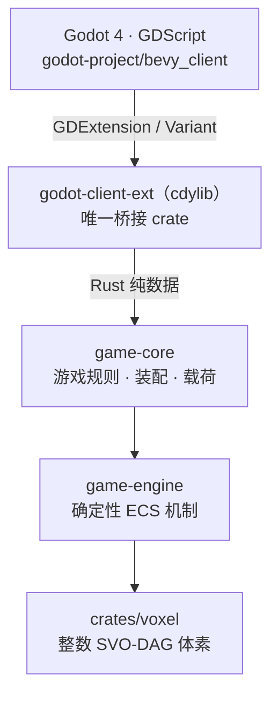
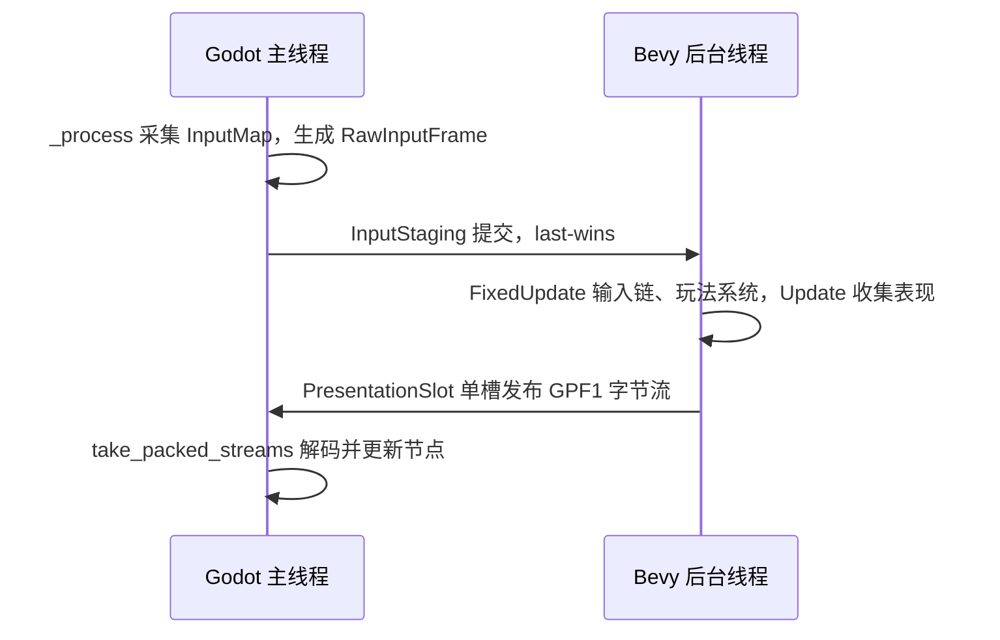

# 项目架构

Voxeldustry 是体素沙盒游戏。架构核心一句话：**Godot 4 只做输入采集与画面表现，确定性模拟跑在后台线程的 Bevy ECS 里，两侧通过纯数据通道交换信息。**

## 技术栈

| 组件 | 版本 | 说明 |
| --- | --- | --- |
| Rust | 1.95 | `workspace.package.rust-version`，CI 固定同一版本 |
| Bevy | 0.19 | 关闭默认特性，核心不渲染 |
| godot-rust | 0.5.5（`api-4-2`） | GDExtension 绑定，按 4.2 API 编译 |
| Godot | 4.7.2 | 编辑器与导出模板版本 |
| avian3d | 0.7 | 体素碰撞，`physics` feature，game-core 默认开 |
| bevy_replicon | 0.43 | 网络适配，`net` feature，默认关 |

## 分层

依赖方向单向，反向依赖视为违规。

## 两条线程

| 线程 | 运行什么 | 约束 |
| --- | --- | --- |
| Godot 主线程 | GDScript 表现层、`BevyAppManager` 节点方法 | `Gd<T>` 是 `!Send + !Sync`，节点方法只能主线程调用 |
| Bevy 后台线程 | `run_headless` 里的 ECS App | 只碰 `ClientBridge` 的纯数据通道，不碰 Godot 类型 |

## 一帧数据流

## 板块导航

| 笔记 | 内容 |
| --- | --- |
| [[01-分层与依赖]] | 四个 crate 的职责、依赖铁律、feature 矩阵 |
| [[02-运行时与线程模型]] | 线程、通道、runner 循环、生命周期 |
| [[03-ECS与调度]] | 插件装配、CoreSpec、SystemSet 顺序、确定性 |
| [[04-输入链路]] | 采集、量化、暂存、解析、事件、能力回传 |
| [[05-表现管线]] | 命令、载荷、GPF1、插值、GDScript 消费侧 |
| [[06-体素世界与材质]] | SVO-DAG、LOD、矩形打包、halo、碰撞、材质管线（Texture2DArray + 烘焙资产） |
| [[07-网络隐私与预测回滚]] | replicon、感知掩码、预测与回滚 |
| [[08-静态数据与Mod体系]] | 静态表、稳定 id、Mod 阶梯 M0-M7 |
| [[09-构建测试与CI]] | build.sh、场景、CI、发布、性能门禁 |
| [[10-Godot-UI方案]] | 单 UI 树、platform / scheme 分离、托盘槽位与重定位、ButtonSpecs 动作按钮、安全区与缩放、暂停、mod UI 注册；含交互意图抽象（hint / select / confirm / context）设计，未实现 |
| [[11-当前状态与风险]] | 已落地、规划中、技术债 |

## 术语速查

| 术语 | 含义 |
| --- | --- |
| tick | 一次固定步长逻辑推进，默认 60 Hz |
| chunk | 32³ 体素的寻址单元 |
| halo | 块外一圈 26 邻块边界，34³ 缓冲 |
| layer | Texture2DArray 的层号；本项目里 layer == 材质 id |
| 烘焙瓦片 | bake 工具从 VoxelMaterial 作者参数生成的 tiles/*.res，运行时不生成像素 |
| rect | 贪婪网格合并后的整数矩形，39 bit 描述符 |
| body | 一块独立体素载体：岛、船、建筑、自动机 |
| 单槽 | 表现帧只保留最新一帧的 `PresentationSlot` |
| GPF1 | 表现帧线格式，帧头加 SoA 池 |
| AOI | 观察者视野，基于空间索引增量维护 |
| FixedPoint | I40F24 定点数，逻辑层唯一数值类型 |

## 维护约定

- 每个笔记只讲一个主题。架构变化时改对应笔记，不新建重复笔记。
- 引用代码写仓库相对路径，例如 `game-engine/src/sim.rs`。
- 正文用中文，代码标识符保持原拼写。
