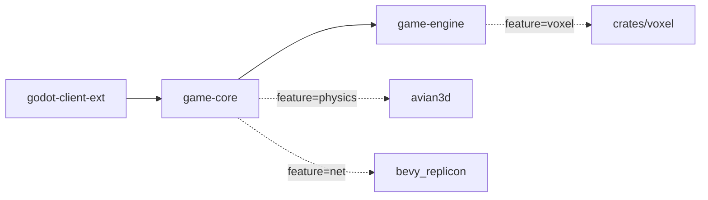

# 分层与依赖

workspace 四个成员加一个 Godot 工程，依赖严格单向。

## crate 职责

| crate | 路径 | 产物 | 职责 |
| --- | --- | --- | --- |
| `voxel` | `crates/voxel` | rlib | 整数 SVO-DAG 体素存储、贪婪网格、LOD 四叉树、确定性存档 |
| `game-engine` | `game-engine` | rlib | 通用确定性 ECS 机制：装配接缝、输入、表现管线、空间与 AOI、感知、回滚、Mod、体素世界层 |
| `game-core` | `game-core` | rlib | 本游戏：`CoreGame` 装配、玩法、静态数据、体素游戏层、表现载荷、预测绑定、后台入口 |
| `godot-client-ext` | `godot-client-ext` | cdylib | 唯一桥接 crate，`Variant ↔ game_core` 机械转换 |
| Godot 工程 | `godot-project` | pck | GDScript 表现层、场景、`.gdextension` |

`crates/chunky-bevy` 是 vendored 参考实现（Bevy chunk 管理，MIT OR Apache-2.0），**不在 workspace members 里**，当前不参与构建。

## 依赖图

feature 开关只影响依赖树，不改变分层方向。

## 边界铁律

1. `game-core` 不依赖 `godot` crate。跨边界类型要么在 `game-core` 定义，要么从 `game_engine` 取。
2. `godot-client-ext` 只做类型搬运。出现业务 `match` 或常量表即违规：动作表在 `game_core::input::actions`，载荷在 `game_core::presentation::payload`。
3. `crates/voxel` 只用整数体素坐标。不知道 `voxel_size`，不碰 `Transform`，不依赖 Bevy。
4. `static_data` 只依赖 `game_engine::ids`，不依赖 `presentation` 或 `godot`。
5. 表现层不反向依赖世界层；`game_engine::voxel` 不依赖 `game_engine::presentation::voxel`。
6. 违反以上任一条的依赖，在评审阶段直接拒绝。

## feature 矩阵

| feature | 所属 crate | 默认 | 作用 |
| --- | --- | --- | --- |
| `voxel` | game-engine | 关 | 引入 `crates/voxel`，启用体素世界层 |
| `physics` | game-engine / game-core | game-core 默认开 | 引入 avian3d，派生体素碰撞几何 |
| `net` | game-engine / game-core | 关 | 引入 bevy_replicon，启用网络适配 |

`game-core` 默认开 `physics`，`--no-default-features` 可构建无物理版本。

## 版本绑定

| 项 | 位置 | 当前值 |
| --- | --- | --- |
| Rust | `Cargo.toml` 的 `workspace.package.rust-version` 与 CI 的 `RUST_TOOLCHAIN` | 1.95 |
| Bevy | `Cargo.toml` 的 `workspace.dependencies` | 0.19，`default-features = false` |
| godot crate | `godot-client-ext/Cargo.toml` | 0.5.5，`api-4-2` |
| Godot | CI 的 `GODOT_VERSION` 与 `project.godot` | 4.7.2 |

## 稳定 API 承诺

`game-engine/src/lib.rs` 列出的模块与类型是 mod 与下游的承诺面，只增不改：`GameSpec`、`EngineSet`、`InputSet`、`GameModule`、`Mod*`、`PresentationPayload`、`ClientBridge`，以及 `ids` / `identity` / `math` / `spatial` / `aoi` / `perception`。

## 新增依赖的检查清单

- 机制进 `game-engine`，业务进 `game-core`，Godot 相关只进 `godot-client-ext`。
- 是否打破 `game-core` 的无 godot 约束。
- 是否在确定性路径引入 f32 或 HashMap 迭代序。
- 是否该用 feature 隔离，避免污染默认依赖树。
