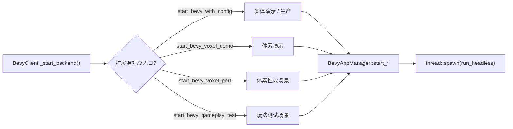

# 运行时与线程模型

## 两个线程

| 线程 | 做什么 | 禁止 |
| --- | --- | --- |
| Godot 主线程 | GDScript 表现层、`BevyAppManager` 的全部节点方法 | 直接跑 Bevy 系统，跨线程持有 `Gd<T>` |
| Bevy 后台线程 | `game-engine::backend::run_headless` 里的 `App` | 碰任何 Godot 类型 |

`godot-rust` 的 `Gd<T>` 是 `!Send + !Sync`，节点方法只能主线程调用。后台线程只通过 `ClientBridge` 的 `Arc` 句柄交换纯数据。

## ClientBridge 的四个句柄

| 字段 | 类型 | 方向 |
| --- | --- | --- |
| `input` | `InputStaging` | Godot 写、Bevy 读 |
| `slot` | `PresentationSlot<S::Payload>` | Bevy 写、Godot 取 |
| `events` | `PresentationEventQueue<S::Event>` | Bevy 推、Godot drain |
| `semantics` | `S::Semantics` | 双方共享，运行期注册 |

四个字段都是 `Arc` 内部的克隆句柄，克隆一次两个线程各持一份。

## 控制与生命周期通道

| 通道 | 类型 | 方向 |
| --- | --- | --- |
| `to_bevy` | `Sender<BevyControlMsg>` | Godot 到 Bevy |
| `from_bevy` | `Receiver<FromBevy>` | Bevy 到 Godot |

`BevyControlMsg`：`Pause`、`Resume`、`Shutdown`、`Custom(String)`。
`BevyLifecycleMsg`：`Started`、`Paused`、`Resumed`、`Error(String)`、`Custom(String)`、`Stopped(i64)`。
`FromBevy { session, payload }` 的 `session` 每次启动自增，Godot 侧据此丢弃上一个线程的残留消息。

## 启动路径



`has_method` 是前向兼容兜底：扩展没有新入口时回退到实体演示，场景仍能启动。

## runner 循环

`run_headless` 装配 `MinimalPlugins`、`GameModule`、`Time::<Fixed>::from_hz(fixed_hz)`，然后接管 `set_runner`：

1. 执行一次 `app.finish()` 与 `app.cleanup()`。
2. 每轮先 drain 控制通道，处理暂停与退出。
3. 测出 `delta = now - last_update`，写进 `TimeUpdateStrategy::ManualDuration(delta)`。
4. 调用 `app.update()`。
5. 不足 `1 / runner_hz` 就 sleep 补足。

```text
loop {
    drain ctrl channel
    if paused { sleep 10ms; continue }
    delta = now - last_update
    TimeUpdateStrategy::ManualDuration(delta)
    app.update()
    sleep(target_frame_time - elapsed)
}
```

## 时间与确定性

| 参数 | 来源 | 默认 |
| --- | --- | --- |
| `fixed_hz` | `BevyBackendConfig` 或 GDScript 的 `fixed_hz` | 60 |
| `runner_hz` | 同上 | 60 |

- `FixedUpdate` 每 1/60 秒推进一个 tick，时间由 `ManualDuration(delta)` 累积。
- `runner_hz` 只决定每帧喂多少墙钟时间，不改变单个 tick 的计算。
- 因此帧率变化只改变每帧执行的 tick 数量，同样输入序列得到同样结果。

## 错误与退出

- 后台线程 panic 用 `catch_unwind` 捕获，经通道发 `Error(msg)` 与 `Stopped(1)`，不能让 panic 穿过 FFI。
- 正常退出发 `Stopped(0)`。
- 暂停时 `runner_bridge.set_input_suspended(true)`，恢复时清零，暂停期间的输入不进入模拟。

## Godot 侧拉取

`bevy_client.gd` 的 `_process` 每帧：

1. 组装并 `submit_input_frame`。
2. `BevyBridge.take_frame()` 取表现帧，默认走 `take_packed_streams`。
3. `BevyBridge.render_alpha()` 取插值 alpha。
4. 解码并更新节点，`drain_events()` 交给事件路由器。

帧为空表示本 tick 没有新帧。先取再判空，避免对空字节流解析。
