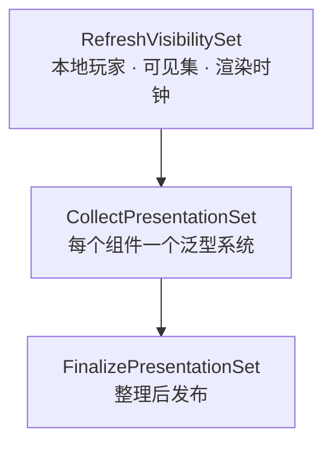
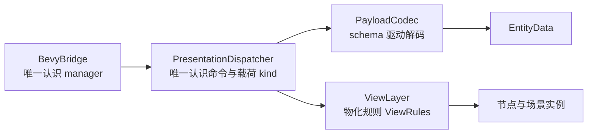

# 表现管线

目标：ECS 状态增量推给 Godot，Godot 不做业务判断，只按数据物化节点。

## 三个 Update 阶段

`collect_component<T: ToPresentation>` 只遍历本帧可见实体，不全世界扫 archetype。

## 命令

| 命令 | kind | 含义 |
| --- | --- | --- |
| `ATTACH` | 0 | 实体进入表现层，带初始载荷集合 |
| `ADD` | 1 | 某个载荷首次出现 |
| `UPDATE` | 2 | 载荷值变化 |
| `REMOVE` | 3 | 载荷移除 |
| `DETACH` | 4 | 离开视野，逻辑实体仍在 |
| `DESPAWN` | 5 | 实体真的消失 |

`DETACH` 与 `DESPAWN` 语义不同：前者回收节点，后者永久移除。

## 载荷表

| code | 名称 | 载荷 | 门控 |
| --- | --- | --- | --- |
| 0 | `transform` | `RenderTransformSample` | 无 |
| 1 | `presentation` | `PresentationState` | 无 |
| 2 | `health` | `PresentedHealth` | `ExactHealth` 可见性 |
| 3 | `visibility` | `PresentedVisibility` | 无 |
| 4 | `interaction` | `InteractionHint` | 无 |
| 5 | `ext` | `ExtensionPayload` | 无 |
| 6 | `prototype` | `PresentedPrototype` | 无 |
| 7 | 留空 | 无 | 已删除的 `RectList`，禁止复用 |
| 8 | `rawvoxels` | `RawVoxelPayload` | 无 |
| 9 | `rawvoxelgroups` | `RawVoxelGroupPayload` | 无 |
| 10 | `camera` | `PresentedCamera` | 无 |
| 11 | `inputcaps` | `PresentedInputCaps` | 无 |

code 只追加。Rust 与 GDScript 两侧枚举的一致性由 `packed::tests::godot_payload_enum_matches_rust_registry` 校验。

## 单槽与事件

- `PresentationSlot` 只保留最新一帧：Bevy 写、Godot 取。被覆盖次数记在 `frames_overwritten`，用于诊断 Godot 掉帧。
- 表现事件走独立队列 `PresentationEventQueue`，容量 `EVENT_QUEUE_CAPACITY`，不占表现帧。
- `PresentationRuntime` 携带 `session`，Godot 据此丢弃重启前的残留帧。

## 线格式 GPF1

一帧由帧头、若干载荷流与 SoA 池组成：

| 池 | 内容 |
| --- | --- |
| f32 池 | 位置、角度、插值端点 |
| i32 池 | id、枚举、字节缓冲长度、扩展袋 |

三种消费通道：

| 通道 | 取法 | 说明 |
| --- | --- | --- |
| `DICTIONARY` | `take_presentation_frame()` | 最慢，调试用 |
| `PACKED_DICTIONARY` | `take_packed_presentation_frame()` 后解析 | 字节流解成字典 |
| `PACKED_STREAMS` | `take_packed_streams()` | 默认，直接给 SoA 与帧头，省字节拷贝 |

## 插值

- `FixedPostUpdate` 记录每个 tick 的 `PresentedTransform { prev, curr }` 与 `RenderClockState`。
- `compute_alpha` 由渲染时钟算出 `render_alpha`，Godot 用它在 prev 与 curr 之间采样。
- 角度用 `lerp_angle`，避免绕圈；位置线性插值。
- `CameraRig` 读同一个 `render_alpha`，相机与实体采样同步。

## GDScript 消费侧

- 数据与视图分离：命令只改 `EntityData`；帧末对 touched id 求值一次物化规则，惰性 acquire、refresh、release。
- `PayloadCodec` 按 `BevyEnums.PAYLOAD_SCHEMA` 解码，新增载荷只需加一行 schema 与 Rust 侧定义。
- `ViewLayer` 与 `ViewRules` 决定 id 何时物化成节点、何时回收。
- `EntityInterpolator` 每帧采样位置与朝向；`EventRouter` 与 `EventPresenter` 处理声音、动画、VFX。
- `RAWVOXELS` 走 `BYTES` 线型，`RAWVOXELGROUPS` 走 `CHUNK_BLOCKS` 线型，每块带 `skirt_mask`。

## 新增一个载荷的步骤

1. Rust：在 `game-core/src/presentation/payload/mod.rs` 的 `define_payloads!` 末尾追加 code。
2. Rust：实现 `PackedPayload`（GPF1 字节布局）与 `ToPresentation`。
3. Rust：在 `register_synced_components` 注册组件。
4. GDScript：在 `contract/bevy_enums.gd` 加枚举与 schema 行。
5. 更新两侧一致性测试，跑 `cargo test --workspace`。
