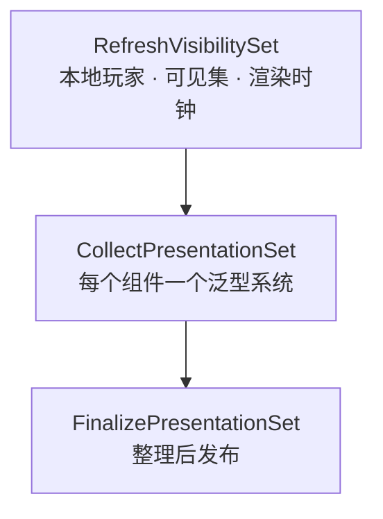
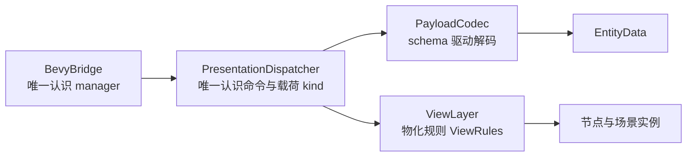

# 表现管线

目标：ECS 状态增量推给 Godot，Godot 不做业务判断，只按数据物化节点。

## 三个 Update 阶段

`collect_component<T: ToPresentation>` 只遍历本帧可见实体，不全世界扫 archetype。

## 命令

| 命令 | kind | 含义 |
| --- | --- | --- |
| `ATTACH` | 0 | 实体进入表现层，带初始载荷集合 |
| `ADD` | 1 | 某个载荷首次出现 |
| `UPDATE` | 2 | 载荷值变化 |
| `REMOVE` | 3 | 载荷移除 |
| `DETACH` | 4 | 离开视野，逻辑实体仍在 |
| `DESPAWN` | 5 | 实体真的消失 |

`DETACH` 与 `DESPAWN` 语义不同：前者回收节点，后者永久移除。

## 载荷表

| code | 名称 | 载荷 | 门控 |
| --- | --- | --- | --- |
| 0 | `transform` | `RenderTransformSample` | 无 |
| 1 | `presentation` | `PresentationState` | 无 |
| 2 | `health` | `PresentedHealth` | `ExactHealth` 可见性 |
| 3 | `visibility` | `PresentedVisibility` | 无 |
| 4 | `interaction` | `InteractionHint` | 无 |
| 5 | `ext` | `ExtensionPayload` | 无 |
| 6 | `prototype` | `PresentedPrototype` | 无 |
| 7 | 留空 | 无 | 已删除的 `RectList`，禁止复用 |
| 8 | `rawvoxels` | `RawVoxelPayload` | 无 |
| 9 | `rawvoxelgroups` | `RawVoxelGroupPayload` | 无 |
| 10 | `camera` | `PresentedCamera` | 无 |
| 11 | `inputcaps` | `PresentedInputCaps` | 无 |
| 12 | `custom` | `CustomPayload`（mod 子种类） | 见下节 schema 可见性 |

code 只追加。Rust 与 GDScript 两侧枚举的一致性由 `packed::tests::godot_payload_enum_matches_rust_registry` 校验。

## mod 自定义表现载荷（Custom / sub_kind）

`code 12` = `custom`，载荷类型 `CustomPayload`：**一个实体、多个子种类的整包快照**。
mod 在自己的系统里往实体的 `ModPresentation` 组件写字段，collector 按 sub_kind 的 schema
投影后整包下发（不是每字段一条命令），因此同一实体上不同 mod / 不同表现种类互不覆盖。

值模型：

- `CustomPayload { groups: Vec<ModPayloadGroup> }`，`ModPayloadGroup { sub_kind: u16, fields: Vec<ExtField> }`；
- 字段复用扩展袋的 `ExtField` / `ExtValue`（`I32` / `Bool` / `Tags`）；
- 规范化：组按 `sub_kind` 升序、组内字段按 `key` 升序。顺序由构造入口
  `CustomPayload::from_groups` 保证，mod 的写入顺序不影响字节。

线格式（`impl PackedPayload for CustomPayload`）：

| 段 | 内容 |
| --- | --- |
| body | `u32 group_count`，然后每组 `u16 sub_kind + u32 field_count + 字段…` |
| 字段 | `u32 key + u8 tag + 值`（tag 0=i32、1=bool、2=tags；与扩展袋逐字节一致，共用 `packed.rs` 里的 helper） |
| i32 池 | `group_count`，每组 `sub_kind`，然后按字段顺序 `field_count, key, tag, 值…` |

上限：

| 项 | 上限 | 常量 |
| --- | --- | --- |
| 组数 | 32 | `MAX_MOD_PAYLOAD_GROUPS` |
| 每组字段数 | 1024 | `MAX_EXT_FIELDS` |
| 单个 Tags 值 | 4096 | `MAX_EXT_TAGS` |

写入侧 `put_body` / `write_pools` 按上限 clamp 兜底；解码侧组数超限返回
`PackedError::TooManyModGroups`，未知字段 tag 返回 `PackedError::BadExtensionTag`
（整帧拒绝，不做静默跳过）。构造入口 `from_groups` 另行拒绝重复 sub_kind / 重复 key。

sub_kind 分配（装配期派生、跨端一致、**不进存档**）：

- `ModManifest.presentation: &'static [ModPayloadSpec]` 声明子种类与字段；
- `Mods::apply` 按拓扑排序后的 mod 顺序、每个 mod 的 manifest 声明顺序从 **1** 递增分配
  （0 保留给核心/未分配），结果注入 `ResolvedModPayloads` 资源，并由 `bevy_backend`
  发布到全局快照 `publish_mod_payloads` / `mod_payload_table()`；
- 同一 mod 内子种类重名、同一 spec 内字段 key 重复、sub_kind 超过 `u16::MAX` 都是
  `ModError::Presentation(..)` 装配失败（错误码 `mod.presentation`）；
- sub_kind 只取决于「存档冻结的 mod 清单」，读档重建结果与服务端一致；表本身不进存档。

字段可见性（按所属 sub_kind 的 schema 求值）：

- `All` 恒可见，`ServerOnly` 恒隐藏，`Required` 需观察者感知命中 `required_bits`
  （`required_bits == 0` 同样隐藏，Fail-Closed）；
- 未在 schema 登记的字段隐藏；找不到 schema 的 sub_kind 整组丢弃（每个 sub_kind 只记一次 debug）；
- 无任何可见字段时 collector 发 `REMOVE` 并清基线（与扩展袋一致）；投影未变不重发。

Godot 侧按 sub_kind 查表：

1. 世界加载完成后调 `BevyRuntimeNode.get_mod_payload_table()`（与 `get_action_table` 同生命周期），
   返回 `Array[{ sub_kind, mod_id, name, fields: [{ key, name, vis, required_bits }] }]`，
   `vis` 用整数 0/1/2 对应上述三种可见性；
2. 收到 `CUSTOM` 载荷（字典通道为 `{ groups: [{ sub_kind, fields: [{ key, tag, value }] }] }`）时，
   用 `sub_kind` 查表把字段 key 翻成人可读名，再交给对应渲染器；
3. 表里查不到的 `sub_kind` 应整组忽略——客户端表可能落后于服务端；
4. `PayloadCodec` 已支持 `MOD_GROUPS` 线型：`PACKED_STREAMS` 通道解出的值与字典通道同形
   （`[{ sub_kind, fields: [{ key, tag, value }] }]`）；未知字段 tag 整组拒绝并保留旧值。

## 单槽与事件

- `PresentationSlot` 只保留最新一帧：Bevy 写、Godot 取。被覆盖次数记在 `frames_overwritten`，用于诊断 Godot 掉帧。
- 表现事件走独立队列 `PresentationEventQueue`，容量 `EVENT_QUEUE_CAPACITY`，不占表现帧。
- `PresentationRuntime` 携带 `session`，Godot 据此丢弃重启前的残留帧。

## 线格式 GPF1

一帧由帧头、若干载荷流与 SoA 池组成：

| 池 | 内容 |
| --- | --- |
| f32 池 | 位置、角度、插值端点 |
| i32 池 | id、枚举、字节缓冲长度、扩展袋 |

三种消费通道：

| 通道 | 取法 | 说明 |
| --- | --- | --- |
| `DICTIONARY` | `take_presentation_frame()` | 最慢，调试用 |
| `PACKED_DICTIONARY` | `take_packed_presentation_frame()` 后解析 | 字节流解成字典 |
| `PACKED_STREAMS` | `take_packed_streams()` | 默认，直接给 SoA 与帧头，省字节拷贝 |

## 插值

- `FixedPostUpdate` 记录每个 tick 的 `PresentedTransform { prev, curr }` 与 `RenderClockState`。
- `compute_alpha` 由渲染时钟算出 `render_alpha`，Godot 用它在 prev 与 curr 之间采样。
- 角度用 `lerp_angle`，避免绕圈；位置线性插值。
- `CameraRig` 读同一个 `render_alpha`，相机与实体采样同步。

## GDScript 消费侧

- 数据与视图分离：命令只改 `EntityData`；帧末对 touched id 求值一次物化规则，惰性 acquire、refresh、release。
- `PayloadCodec` 按 `BevyEnums.PAYLOAD_SCHEMA` 解码，新增载荷只需加一行 schema 与 Rust 侧定义。
- `ViewLayer` 与 `ViewRules` 决定 id 何时物化成节点、何时回收。
- `EntityInterpolator` 每帧采样位置与朝向；`EventRouter` 与 `EventPresenter` 处理声音、动画、VFX。
- `RAWVOXELS` 走 `BYTES` 线型，`RAWVOXELGROUPS` 走 `CHUNK_BLOCKS` 线型，每块带 `skirt_mask`。

## 新增一个载荷的步骤

1. Rust：在 `game-core/src/presentation/payload/mod.rs` 的 `define_payloads!` 末尾追加 code。
2. Rust：实现 `PackedPayload`（GPF1 字节布局）与 `ToPresentation`。
3. Rust：在 `register_synced_components` 注册组件。
4. GDScript：在 `contract/bevy_enums.gd` 加枚举与 schema 行。
5. 更新两侧一致性测试，跑 `cargo test --workspace`。
